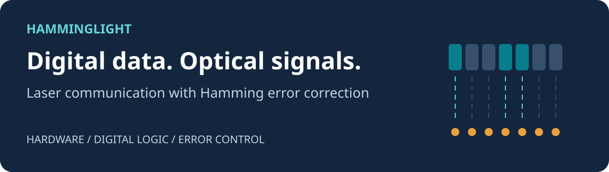
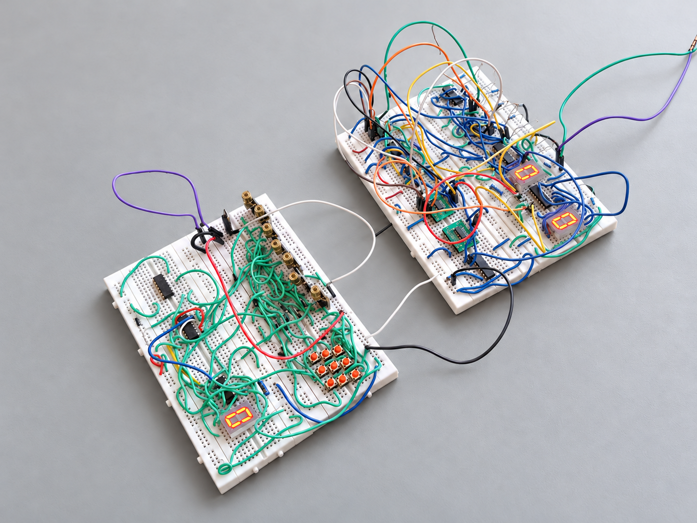
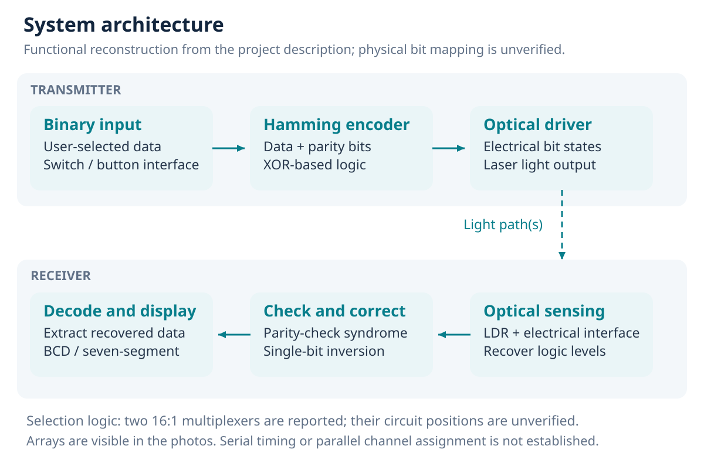
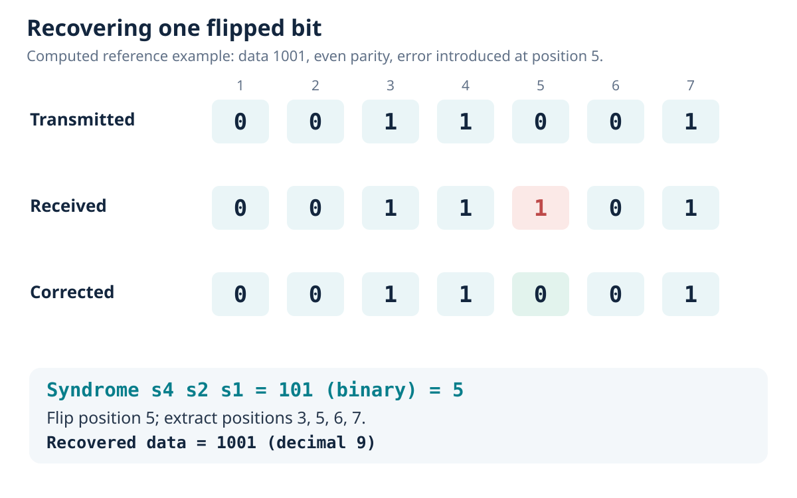

# HammingLight

**Laser-based digital communication with Hamming single-bit error correction.**

> **[Read the full project report (PDF)](HammingLight_Project_Report.pdf)**
>
> Start here: the 14-page report covers the hardware, circuit diagrams, working principles, error correction, and validation.

A breadboard hardware project combining optical transmission, an LDR-based receiver, discrete digital logic, and seven-segment displays. The documentation connects the prototype to the principles of parity generation, error detection, and selected-bit correction.

[How it works](#how-it-works) · [Circuit diagrams](#circuit-diagrams) · [Run the reference demo](#run-the-reference-demo) · [Documentation](#documentation)



*Edited project photograph with background cleanup and the two loose external red/black test leads removed. The [unedited original](assets/photos/01-prototype-overview.jpg) is retained for comparison.*

## Project highlights

- Transmit binary information using laser light.
- Recover electrical logic through an LDR-based optical receiver.
- Use parity checks to locate and correct a single erroneous bit.
- Present numeric information through BCD-to-seven-segment decoding.
- Explore the design through original hardware evidence, circuit drawings, and a reproducible Python reference model.

## How it works



| Stage | Operation |
| --- | --- |
| **1. Input** | Establish the binary data word. |
| **2. Encode** | Generate parity bits before transmitting the protected word. |
| **3. Transmit** | Convert electrical bit states into optical signals. |
| **4. Receive** | Sense light and recover compatible digital levels. |
| **5. Check and correct** | Calculate the syndrome and invert the identified bit under the single-error assumption. |
| **6. Display** | Extract the recovered data and drive the numeric display. |

The photograph shows multiple optical modules. Exact channel mapping, serial/parallel organization, and timing remain to be confirmed from the wiring. See the [technical report](docs/report.md) for the full explanation.

## Hardware

| Component | Purpose |
| --- | --- |
| Laser transmitter | Represent binary states with light |
| LDR-based receiver | Convert illumination changes into electrical signals |
| 7486 XOR gates | Parity operations and conditional inversion |
| 7405 NOT gates | Logic inversion, with open-collector pull-up requirements |
| Two 16:1 multiplexers | Signal selection / Boolean logic; exact assignments unverified |
| BCD-to-seven-segment circuitry | Numeric display decoding |
| Buttons, resistors, LEDs, jumper wires, and breadboards | Control, interfacing, indication, and construction |

The named ICs and multiplexer quantity come from the project description. See the [component inventory](docs/components.md) for identification status and interface notes.

## Error-correction example

The documentation uses an **even-parity Hamming(7,4) reference model**. Positions **1 to 7 run left to right** in the order `p1 p2 d1 p4 d2 d3 d4`. This model explains the method; the prototype's exact code variant has not been traced.

| Step | Value |
| --- | --- |
| Input data | `1001` (decimal 9) |
| Encoded word | `0011001` |
| Received word, with position 5 flipped | `0011101` |
| Syndrome `s4 s2 s1` | `101` (binary) = position 5 |
| Corrected word | `0011001` |
| Recovered data | `1001` |



Ordinary Hamming correction assumes **at most one flipped bit per codeword**. Two-bit errors can produce a misleading syndrome and be miscorrected. The [report](docs/report.md) explains this limit and extended Hamming coding.

## Circuit diagrams

These drawings define reference circuits for the documented principles. They are separate from a pin-level schematic of the photographed prototype.

| Drawing | Editable vector | PNG |
| --- | --- | --- |
| Hamming parity encoder | [SVG](assets/diagrams/parity-encoder-circuit.svg) | [PNG](assets/diagrams/parity-encoder-circuit.png) |
| Selected-bit correction XOR | [SVG](assets/diagrams/correction-xor-circuit.svg) | [PNG](assets/diagrams/correction-xor-circuit.png) |
| 7405 inverter and pull-up | [SVG](assets/diagrams/7405-pullup-circuit.svg) | [PNG](assets/diagrams/7405-pullup-circuit.png) |
| LDR receiver interface | [SVG](assets/diagrams/receiver-reference.svg) | [PNG](assets/diagrams/receiver-reference.png) |

<details>
<summary><strong>View the gate-level parity encoder</strong></summary>


</details>

<details>
<summary><strong>View correction, inverter, and receiver circuits</strong></summary>


</details>

More detail: [circuit guide](docs/circuit-diagrams.md).

## Run the reference demo

**Requirement:** Python 3. No external packages are needed.

```bash
git clone https://github.com/kishan3113/hamming-light.git
cd hamming-light
python3 reference/hamming74.py --data 1001 --flip 5
```

Example output:

```text
Input: 1001 | Transmitted: 0011001 | Received: 0011101
Syndrome: 101 | Assumed error position: 5
Corrected: 0011001 | Recovered: 1001
Reference model only; assumes at most one flipped bit.
```

Run the exhaustive reference checks:

```bash
python3 reference/hamming74.py --self-test
```

```text
PASS: 16 clean + 112 single-bit cases = 128 cases
Two-bit ambiguity confirmed; these are software checks, not hardware tests.
```

The companion checks all 16 data words without errors and with each of the seven possible single-bit flips. It was written for this documentation and is not firmware from the hardware prototype. See the [validation record](docs/reference-checks.txt).

## Visual gallery

<details>
<summary><strong>View the generated concept illustrations</strong></summary>


These illustrations use the original photos as visual references. Component appearance, counts, and wiring are representative. They are labelled as reconstructions and are not measurement evidence.

</details>

## Documentation

| Resource | Contents |
| --- | --- |
| [Full report (PDF)](HammingLight_Project_Report.pdf) | Main review document, available directly in the repository root |
| [Editable report](docs/report.md) | Technical explanation in Markdown |
| [Circuit guide](docs/circuit-diagrams.md) | Gate networks and electrical interfaces |
| [Component inventory](docs/components.md) | Roles, identification status, and interface considerations |
| [Photographic analysis](docs/photo-analysis.md) | Observations from the three supplied images |
| [Testing guide](docs/testing.md) | Reference checks and proposed hardware measurements |
| [Technical references](docs/references.md) | Manufacturer and educational sources |
| [Photo edit record](docs/photo-edit.md) | Background cleanup and original source |

## Repository structure

| Path | Contents |
| --- | --- |
| `HammingLight_Project_Report.pdf` | Main project report, visible in the top-level file list |
| `assets/photos/` | Unchanged original photos and the cleaned overview |
| `assets/illustrations/` | Generated concept illustrations |
| `assets/diagrams/` | Eight SVG/PNG assets: banner and seven technical figures |
| `docs/` | Supporting notes, editable report, evidence analysis, and testing guidance |
| `reference/` | Standard-library Python reference model |

## Current record and next steps

| Area | Status |
| --- | --- |
| Physical construction and powered displays | Visible in the original photographs |
| Laser/LDR link, named logic ICs, and Hamming correction | Reported project features |
| Reference-model validation | 128 clean/single-bit cases passed |
| As-built wiring, code variant, and display assignments | Await circuit tracing |
| Distance, data rate, BER, and power consumption | No bench measurements supplied |

Useful next steps are to label the optical channels, trace the circuit, record controlled error-correction trials, and measure operation under different distances and lighting conditions. Alignment, ambient light, sensor settling, and threshold stability are the main practical considerations. A BCD-only display path also needs suitable handling for arbitrary binary values 10-15.

When reproducing the optical setup, use a suitable laser module and driver and keep the beam away from eyes.
