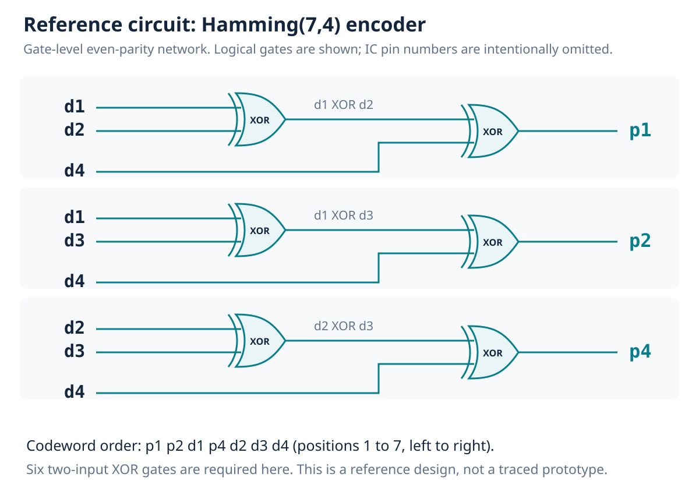
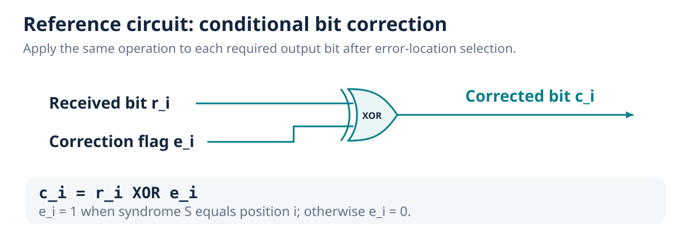
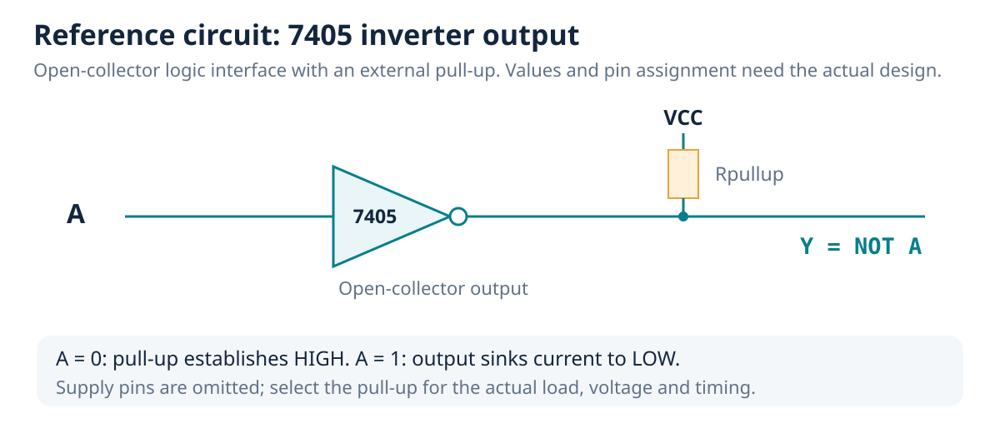
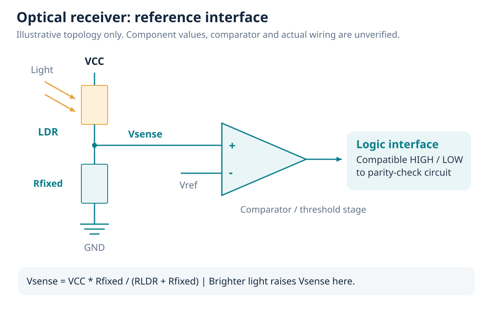
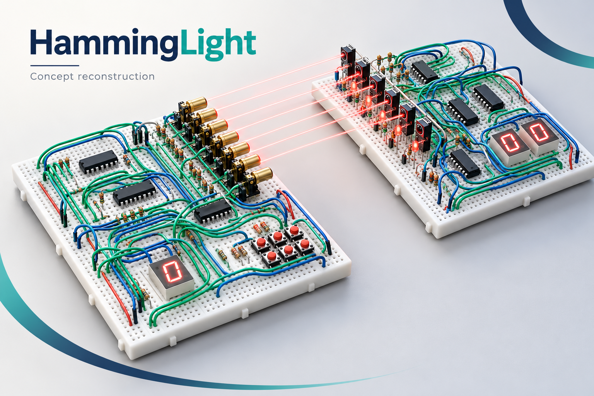
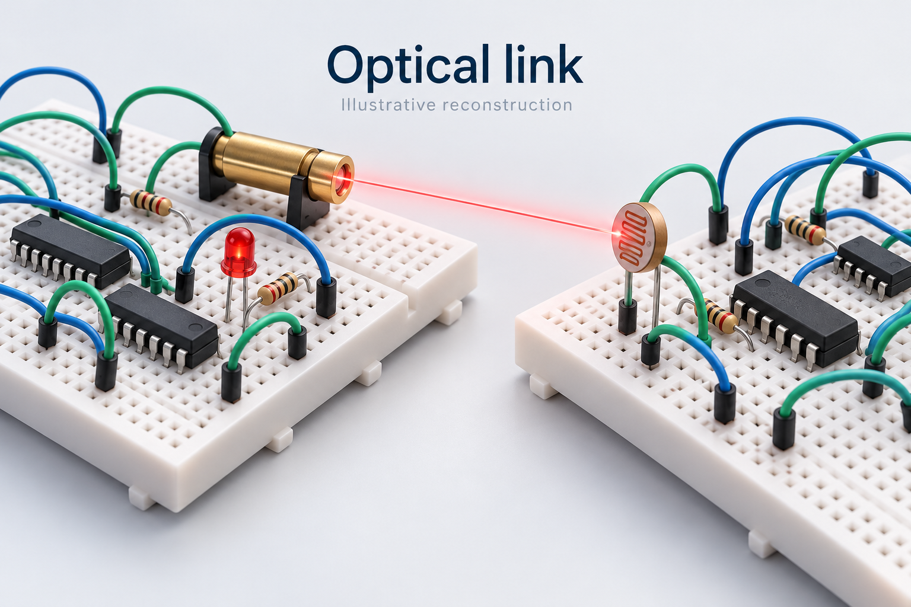

# Circuit diagrams and generated illustrations

The supplied photos are visual references. They do not reveal enough nodes to trace an exact as-built schematic. The following drawings provide deterministic, technically defined reference circuits.

## Gate-level parity encoder

The three networks implement `p1 = d1 XOR d2 XOR d4`, `p2 = d1 XOR d3 XOR d4`, and `p4 = d2 XOR d3 XOR d4`. Each needs two two-input XOR gates. The six-gate reference network fits within two quad-XOR packages, with two gates spare; this is not an inferred prototype IC count. Four data bits pass through to their codeword positions.

## Selected-bit correction

For each bit position i, error-location logic generates `e_i = 1` only when the syndrome equals i. Then `c_i = r_i XOR e_i`. This drawing shows the bit-correction gate; the complete syndrome-selection gate implementation and any use of the two multiplexers remain unverified.

## Open-collector inverter interface

The 7405 output sinks current when LOW and otherwise relies on the pull-up for HIGH. This circuit illustrates the required output interface. Supply connections are omitted for clarity. Values, fan-out, pin numbers and timing must be checked against the actual part and circuit.

## Optical receiver interface

This conceptual LDR divider and threshold stage explains light-to-logic conversion. A separate comparator has not been identified in the photos.

## Generated visuals

These two illustrations were generated from the supplied photo references using the built-in image-generation tool. They are concept reconstructions, not photographs or electrical validation. The illustrated wire routing, sensor packages and component counts are representative. All original photos remain unchanged under `assets/photos/`.

The exact generation prompts are recorded in `image-prompts.md`.
