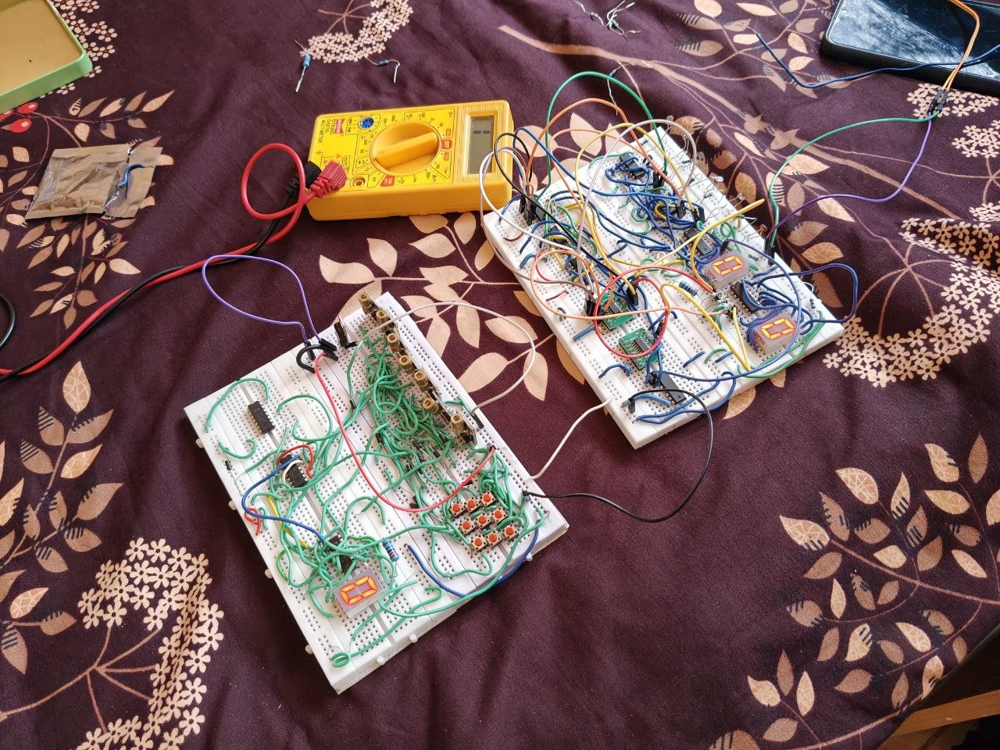
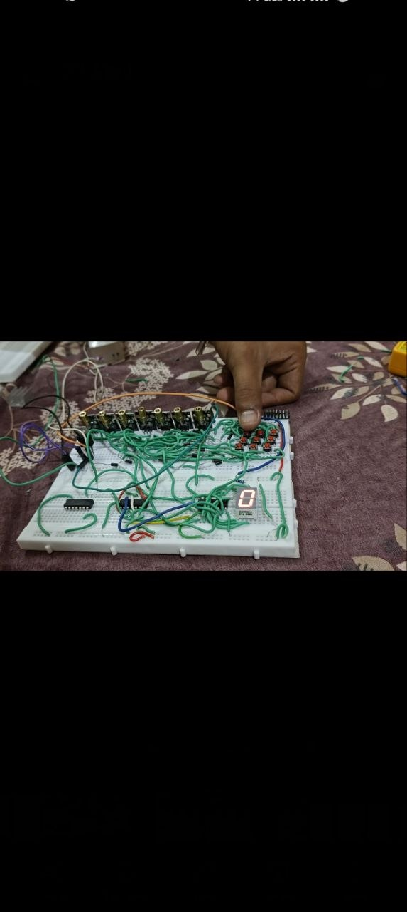
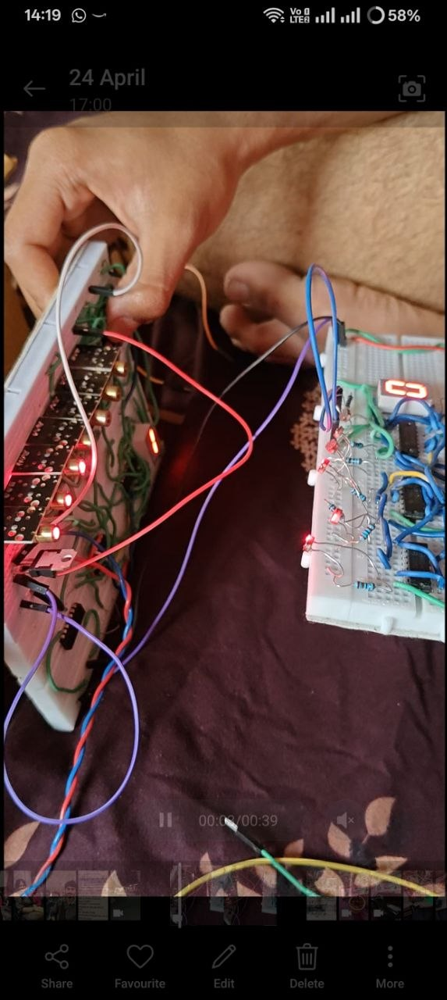

# Photographic analysis

The three originals are preserved without retouching, cropping or removal of visible wiring. Preparation date: 16 October 2026. The files' dates are not treated as the original build date.

## Photo 1: overall construction

The report cover and README use a background-cleaned derivative of this photograph. Its edited status is labelled, and the original below is retained unchanged. See [photo-edit.md](photo-edit.md).

Original filename: `photo_2026-10-16_18-25-17.jpg`.

Two separate breadboard assemblies are visible. The lower-left assembly has a row of metal-fronted optical modules, a cluster of pushbuttons, dense green wiring, DIP packages and one lit seven-segment display. The upper-right assembly contains DIP packages, resistors, a row of small optical/sensing elements, indicator components and two lit seven-segment displays. A multimeter and leads are present nearby.

This establishes the physical prototype and visible powered displays. It does not establish the role of each display, a valid transmitter-to-receiver data match, correct Hamming operation or a calibrated measurement. The multimeter's presence is not a recorded test result. Transmitter/receiver board assignments are plausible from the module arrangement and supplied description, but are not independently traced.

## Photo 2: button and module assembly

Original filename: `photo_2026-10-16_18-25-21.jpg`.

This is a portrait image with a landscape view of one assembly and large black margins. A hand is positioned near the pushbutton area. Optical modules, jumper wires and a lit display are visible. The screenshot cannot establish whether the buttons directly select data, inject errors or perform another control function.

## Photo 3: powered detail

Original filename: `photo_2026-10-16_18-25-22.jpg`.

This is a phone-gallery/video screenshot showing the assemblies from a close side angle. Several red lights and a lit seven-segment display are visible, along with DIP devices, resistors and jumper wires. Red illumination alone cannot identify whether each light is a laser emitter, indicator or reflection. The displayed video duration is not a measured communication time, and the screenshot is not the video itself.

## What remains open

IC legends and many breadboard nodes are obscured. The photos do not establish pin-level wiring, power-rail continuity, channel count, exact sensor models, resistance values, clocking, the Hamming variant or display assignments. All new diagrams therefore explain functions or reference circuits and are labelled accordingly.
