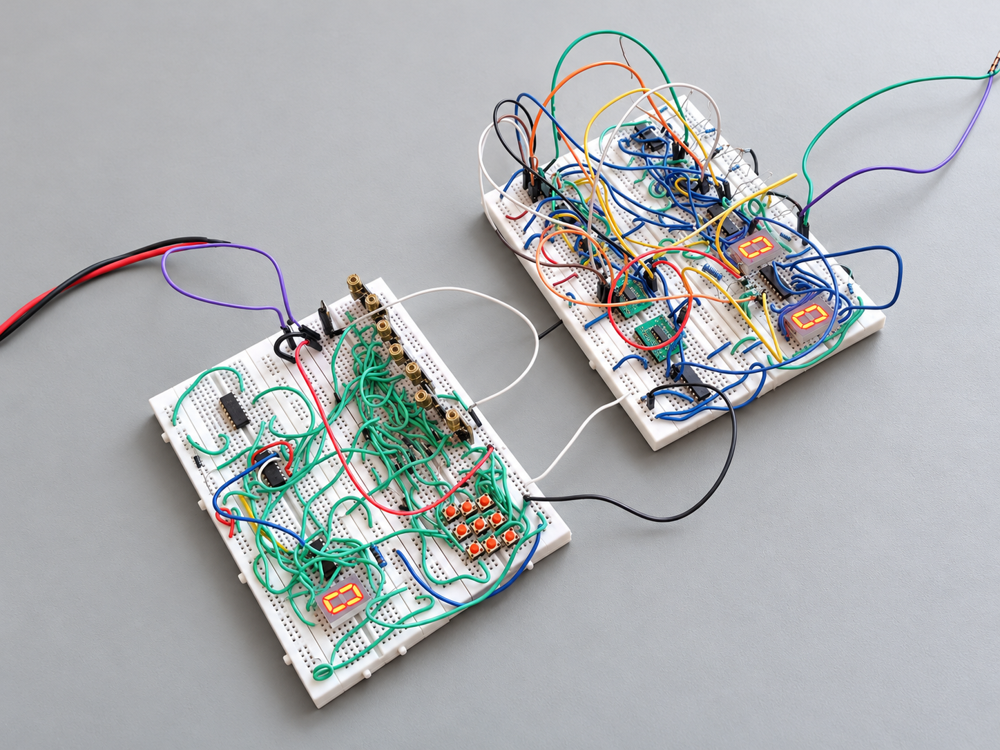
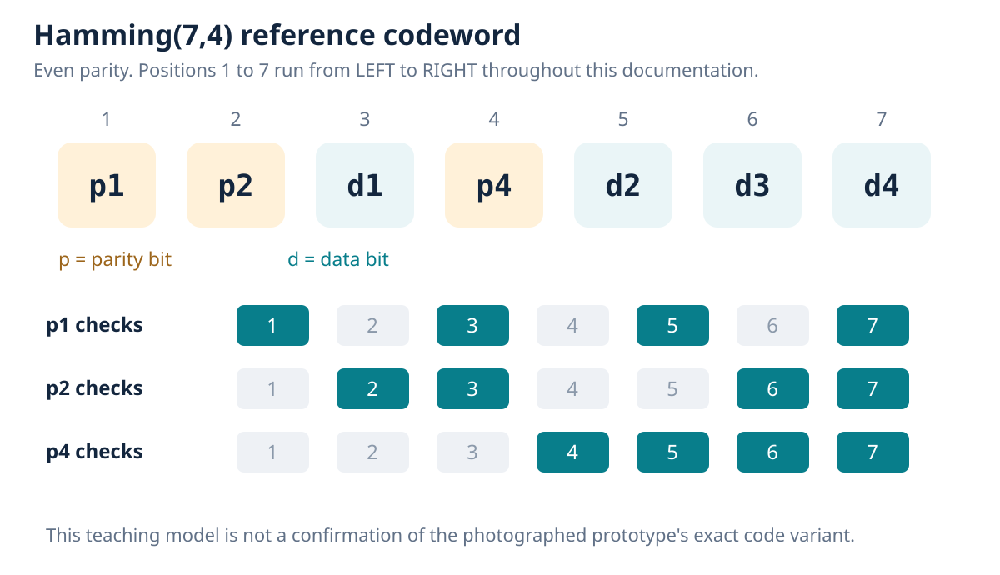

# HammingLight

## Laser-based digital communication and optical transmission

Project report prepared on 16 October 2026.

Repository: https://github.com/kishan3113/hamming-light



The original photograph is retained separately; the edited cover image has a neutral background and clarity adjustments.


## 01. Project overview


### Abstract

HammingLight explores transmitting binary information through laser light and recovering it using an LDR-based receiver. The supplied project description reports 7486 XOR gates, 7405 inverters, two 16:1 multiplexers, Hamming single-bit error correction and BCD-to-seven-segment decoding. Three photographs document the breadboard prototype and illuminated displays. This report connects the reported functions to optical sensing and digital error-control principles.


### Objectives

- Represent binary data as optical states and recover electrical logic at the receiver.
- Explain how redundant parity information can identify one erroneous bit.
- Show the roles of gates, selection logic and numeric display circuitry.
- Provide readable figures, an editable record and reproducible reference calculations.


### Documentation basis

| Category | What is established |
| --- | --- |
| Observed | Two breadboard assemblies, rows of modules, buttons, ICs, indicators and three lit display modules. |
| Reported | Laser/LDR transmission, named gate families, two 16:1 multiplexers and Hamming correction. |
| Reference model | Hamming(7,4), even parity and a conceptual threshold interface explain the principles. |
| Open details | Exact wiring, code variant, module types, timing, channel mapping and measured performance. |

The functional drawings are not a traced as-built schematic. Hamming(7,4) is used consistently as a teaching model, rather than asserted as the photographed circuit's exact implementation.


### Reading guide

| Pages | Contents |
| --- | --- |
| 3-6 | New hardware illustrations, architecture, components and optical reception |
| 7-11 | Hamming model, correction example, digital integration and circuit drawings |
| 12-14 | Validation, limitations, conclusions and technical references |


## 02. Reconstructed hardware visuals

The supplied photos were used as references for these new illustrations. The cleaner views communicate the breadboard hardware and optical-link idea while the original images remain in the supporting photo record.


These are concept reconstructions, not photographs or verified wiring plans. Device appearance, channel count, beam paths and wiring are illustrative. Use the separately drawn reference circuits for the defined electrical and logic relationships.


## 03. Functional architecture


### Signal flow

- Input logic establishes the data word. Parity must be generated before the protected word passes through the optical link.
- The optical driver converts encoded electrical states to laser output. ON = 1 and OFF = 0 is a reference convention; actual polarity needs verification.
- Received light changes the sensor state. The interface recovers compatible digital levels.
- Parity checks form a syndrome. Under the single-bit-error assumption, correction inverts the identified bit and the recovered data is decoded for display.

The rows of modules suggest that multiple optical paths may be present. The photos do not establish whether bits travel in parallel or through a serial timing scheme. A serial link would require timing and word framing; a parallel link would require channel mapping and a suitable settling/sample interval.


## 04. Hardware and component roles

| Component | Function | Identification status |
| --- | --- | --- |
| Laser / optical modules | Emit optical data states | Laser reported; module rows visible; type and count unverified |
| LDR receiver | Sense light through resistance change | Reported; exact sensing device and interface unverified |
| 7486 XOR ICs | Parity and conditional inversion | Reported; photo legends unreadable |
| 7405 inverter ICs | Complement logic signals | Reported; exact circuit placement unverified |
| Two 16:1 multiplexers | Signal selection / Boolean logic | Quantity and ratio reported; part numbers unverified |
| BCD decoder circuitry | Translate decimal data to segments | Reported; driver model unverified |
| Seven-segment displays | Present numeric information | Three lit modules visible; displayed signal roles unverified |
| Buttons, resistors, LEDs | Control, bias and indication | Visible; full values/counts unverified |
| Breadboards and wires | Physical interconnection | Two main assemblies visible |


### Interface considerations

The 7486 family offers independent two-input XOR gates; multi-input parity is formed by cascading operations. The 7405 uses open-collector outputs and needs pull-up resistors for a valid HIGH. Pull-up values depend on load and timing requirements. [1,2]

A multiplexer selects a data input; it is not by itself a Hamming decoder. The complete circuit must perform parity checking, error-location selection and correction. Its exact implementation requires tracing the select, data and output connections.

This is a functional inventory. It is not a procurement-ready bill of materials: resistor values, exact module ratings, power supply details and most quantities are unavailable.


## 05. Optical transmission and reception


### From light to a voltage

An LDR has lower resistance under brighter illumination. [5] In the reference arrangement above, the LDR is connected above a fixed resistor in a voltage divider. Its sense voltage rises when the LDR resistance falls. Swapping the two resistive elements reverses this relationship.

```text
Vsense = VCC * Rfixed / (RLDR + Rfixed)
```


### From a voltage to a bit

A threshold stage compares the sensed voltage with a reference level. Its output, with any needed buffering or pull-up, must satisfy the digital IC input requirements. Hysteresis can reduce repeated transitions around the threshold. A separate comparator is shown only to explain this function; its presence in the prototype is unverified.

Stable operation depends on alignment, light contrast, sensor settling and clean logic levels. No laser wavelength, optical power, receiver response time or data rate can be inferred from the photographs. A suitable laser module/driver should be used, with beams kept away from eyes.


## 06. Hamming coding reference model

Hamming coding adds redundancy so distinct single-bit errors produce distinct parity-check results. This report uses four data bits and three parity bits with even parity. The parity positions are 1, 2 and 4. [6]




### Encoding equations

```text
p1 = d1 XOR d2 XOR d4
p2 = d1 XOR d3 XOR d4
p4 = d2 XOR d3 XOR d4
```

Every group, including its parity bit, has an even number of ones. Positions increase left to right here; this ordering is explicitly defined to avoid ambiguity when copying equations or test vectors.


### Receiving equations

```text
s1 = r1 XOR r3 XOR r5 XOR r7
s2 = r2 XOR r3 XOR r6 XOR r7
s4 = r4 XOR r5 XOR r6 XOR r7
Error position S = s1 + 2*s2 + 4*s4
```

For at most one flipped bit, S = 0 means no error and S = 1 to 7 gives the bit to invert. Outside that assumption, a zero syndrome is not proof of an error-free transmission. [6,7]


## 07. Worked single-bit correction


| Stage | Calculation / value |
| --- | --- |
| Data word | d1 d2 d3 d4 = 1 0 0 1 |
| Parity bits | p1 = 0; p2 = 0; p4 = 1 |
| Received word | r1...r7 = 0 0 1 1 1 0 1 |
| First check | s1 = 0 XOR 1 XOR 1 XOR 1 = 1 |
| Second check | s2 = 0 XOR 1 XOR 0 XOR 1 = 0 |
| Third check | s4 = 1 XOR 1 XOR 0 XOR 1 = 1 |
| Correction | S = 1 + 0 + 4 = 5; invert received position 5 |
| Extract data | Corrected positions 3,5,6,7 give 1001 (decimal 9) |


### Syndrome lookup under the single-error assumption

| s4 s2 s1 | 000 | 001 | 010 | 011 | 100 | 101 | 110 | 111 |
| --- | --- | --- | --- | --- | --- | --- | --- | --- |
| Position | None | 1 | 2 | 3 | 4 | 5 | 6 | 7 |

The example was calculated for this report and reproduced by the supplied Python model. The eight syndrome states distinguish the no-error case and seven single-bit locations.


## 08. Logic, multiplexers and display


### Why XOR is useful

| A | B | A XOR B |
| --- | --- | --- |
| 0 | 0 | 0 |
| 0 | 1 | 1 |
| 1 | 0 | 1 |
| 1 | 1 | 0 |

XOR returns 1 for unequal inputs. It therefore acts as addition modulo two for parity logic. A correction flag e can control inversion: corrected_bit = received_bit XOR e. An asserted flag flips the selected bit; a zero flag preserves it. [1]


### What two 16:1 multiplexers can contribute

A 16:1 selector chooses one of 16 data inputs using four select variables. Fixed data-input levels can implement a four-variable truth table. Alternatively, its inputs can carry signals for selection. The reported two devices could support such functions, but their precise tasks cannot be assigned from the photos.

If the installed selector is a 74150, its output is inverted. This is a manufacturer reference detail, not confirmation of that part number in the prototype. Any inversion must be included in the overall truth table. [3]


### Display decoding

A BCD decoder maps decimal inputs 0000 to 1001 onto segment patterns. The decoder must match the display type and output polarity; the 7447A family, for example, uses active-low outputs for common-anode indicators. [4]

Three illuminated display modules are visible. They could be assigned to input, recovered data or error status, but the supplied evidence does not establish those roles. Ordinary binary values 10-15 need conversion or a suitable hexadecimal display decoder; they are not valid single-digit BCD.


### Integration checks

- Confirm supply and input compatibility from the actual IC suffixes and datasheets.
- Identify open-collector outputs and their pull-ups; keep all logic inputs at defined levels.
- Verify parity convention, multiplexer polarity and display input ordering as one complete signal path.


## 09. Gate-level parity encoder

This reference circuit implements the three even-parity equations used in the Hamming(7,4) example. It provides a gate-level drawing with explicit connections, rather than an inferred pin-level reconstruction of the original breadboards.


### Reading the circuit

| Output | First XOR operation | Second XOR operation |
| --- | --- | --- |
| p1 | d1 XOR d2 | Intermediate result XOR d4 |
| p2 | d1 XOR d3 | Intermediate result XOR d4 |
| p4 | d2 XOR d3 | Intermediate result XOR d4 |

Each parity output needs two two-input gates. Six gates fit within two quad-XOR packages, with two gates spare; this is a reference network count, not an identification of the prototype's IC count. [1] The original data bits pass through to positions 3, 5, 6 and 7 of the codeword.

Pin assignments, unused-input handling and supply wiring must follow the actual IC suffix and datasheet. The photographed circuit's code variant and multiplexer roles remain unverified.


## 10. Correction and inverter circuits

The drawings below define the selected-bit correction operation and a standard open-collector inverter interface. They complement the conceptual LDR receiver circuit in Figure 2.


Error-location logic generates one correction flag per required bit. For a single-bit error at position i, e_i is asserted; XOR then flips that bit. The exact gate or multiplexer implementation that generates these flags in the prototype has not been traced.


The 7405 output can sink current for LOW. When its output transistor is off, the external pull-up establishes HIGH. [2] Choose resistor value, supply, load and fan-out from the actual design. This drawing omits power pins and does not claim a particular connection in the prototype.


## 11. Validation and test record


### Completed reference-model validation

The accompanying Python model was created for this documentation. It exhaustively checks all 16 four-bit messages with no errors and with each of seven individual codeword bits flipped. It verifies recovered data, corrected words and reported error positions.

```text
16 clean cases + 112 single-bit cases = 128 PASS
Two-bit ambiguity confirmed in an additional check.
```

These are mathematical software checks. The photos do not supply a corresponding bench-test log.


### Hardware evidence and measurements

| Item | Current record |
| --- | --- |
| Breadboard construction | Visible |
| Illuminated indicators / displays | Visible |
| Single-bit correction trials | Feature reported; no input/output log supplied |
| Distance, speed and BER | Not measured in the supplied record |
| Lighting tolerance and power | Not measured in the supplied record |


### Proposed hardware verification

- Trace the circuit and confirm part numbers, bit order, polarity and supply requirements.
- Verify each light-sensing path for stable ON and OFF states before testing encoded words.
- Apply clean codewords, then introduce one controlled digital inversion at a time. Record syndrome and recovered data.
- Test two-bit inversions, then vary distance and ambient light. Measure raw errors separately from errors after correction.

Blocking a beam is not always a controlled bit flip and can disturb multiple paths. A BCD-only input path may accept only ten digits; binary nodes or LEDs are needed to inspect the full 16-word reference space.

Reproduce the model: python3 reference/hamming74.py --self-test. Detailed logging guidance is included in docs/testing.md.


## 12. Limitations and development path


### Current limits

| Area | Practical implication |
| --- | --- |
| Optical alignment | Displacement can reduce received illumination or affect several paths. |
| Ambient light | Background illumination can reduce contrast at the sensing node. |
| Sensor dynamics | LDR response, interface settling and threshold noise constrain speed. |
| Error model | Basic Hamming correction assumes at most one flipped bit per protected word. |
| Documentation | Hidden wiring and unreadable part legends prevent pin-level reproduction. |
| Numeric output | A single BCD digit does not represent arbitrary values 10-15. |


### Why double-bit errors matter

Two errors can produce the same syndrome as a different single-bit error, so a standard correcting decoder may flip a third bit. [7] Extending the code with overall parity enables single-error correction and double-error detection under a model of at most two errors per word. [6]


### Useful next steps

- Trace the as-built schematic and label every optical channel, data bit and display input.
- Mount optical modules securely; add shielding and stable thresholding as appropriate.
- Record correction trials and measure operating distance, update interval and error rate.
- For a faster redesign, evaluate a suitable photodiode/phototransistor receiver and its interface.
- Consider extended Hamming coding and an explicit uncorrectable-error indicator.


### Conclusion

HammingLight brings optical transmission, sensing and error-control logic into one visible breadboard experiment. The supplied photos document construction, while the reported functions define the intended system. The new diagrams and verified reference calculations make those principles understandable and provide a foundation for a reproducible, fully measured hardware record.


## 13. References and source record

Primary technical references, consulted on 16 October 2026. Component-family examples support the explanations; they do not identify unreadable parts in the photographs.

[1] Texas Instruments. SN74LS86A / 7486 family: Quadruple 2-Input Exclusive-OR Gates.https://www.ti.com/product/SN74LS86A

[2] Texas Instruments. SN7405: inverters with open-collector outputs.https://www.ti.com/product/SN7405

[3] Texas Instruments. Data Selectors/Multiplexers, including SN74150.https://www.ti.com/lit/ds/symlink/sn74ls151.pdf

[4] Texas Instruments. SN7447A: BCD-to-Seven-Segment Decoders/Drivers.https://www.ti.com/product/SN7447A

[5] Advanced Photonix. Light Dependent Resistors.https://www.advancedphotonix.com/our-products/light-dependent-resistor-ldr

[6] University of New Brunswick, EE4253. Error Correction and the Hamming Code.https://www.ece.unb.ca/tervo/ee4253/hamming.shtml

[7] NVIDIA, CUDA-Q Academic. Hamming [7,4,3] Visualizer; includes two-bit ambiguity.https://nvidia.github.io/cuda-q-academic/interactive_widgets/hamming.html


### Project-specific evidence

The builder supplied the project description and three photographs. No original schematic, bill of materials, timing trace, firmware, video file or measurement log was supplied. The screenshots are treated as still images; their dates and video controls are not performance measurements.

| Original filename | Repository copy |
| --- | --- |
| photo_2026-10-16_18-25-17.jpg | 01-prototype-overview.jpg |
| photo_2026-10-16_18-25-21.jpg | 02-input-assembly.jpg |
| photo_2026-10-16_18-25-22.jpg | 03-powered-detail.jpg |

The three original repository photos remain unchanged. The cover uses an edited version of the overall photo with AI-assisted background cleanup; its edit record is in docs/photo-edit.md. Two concept illustrations and seven technical figures accompany it. Image prompts are recorded in docs/image-prompts.md. The reference model is a documentation companion, not hardware firmware.
